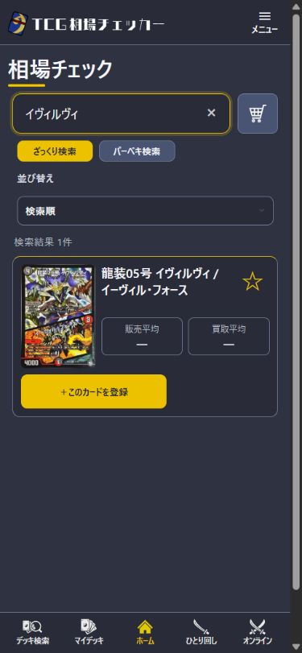

# Card image release — 2026-10-29 JST

The user designated this chat as the sole integration/release owner. The prior search release completed; baseline main and fixed Vercel Production alias were `02e714af00a952caf4689c49341ac989a0b5a921`, READY. Baseline Supabase project: `fxhlobydispnbywxhirn`, 181 migrations, latest `20261028040039`. No repair/reset or unrelated merge is part of this change.

## Scope and adoption decisions

- Original audit: 23,636 active images; 468 below 300px and 159 without dimension metadata.
- 227 candidate prints passed native dimensions/aspect/format/hash/q78 regeneration checks. Four have additional exact-print visual and official-text confirmation and are selected here. The remaining 223 are held because independent exact printed-text/visual confirmation is incomplete; they are not declared incorrect or approved based on a similarity score.
- Another 241 small prints remain unresolved: 237 had no exact-number candidate on the first NEM search page, and 4 had only a sub-384px candidate. This was not an exhaustive search of the entire web.
- Selected IDs: **12817** (DMRP09 5/102), **12827** (DMRP09 3/102), **13118** (DMRP08 G5/G5), **13610** (DMRP06 S6/S10). Both faces of the twinpact cards and the gold-frame/foil treatment of G5/G5 were compared, including costs, powers, abilities, flavor text, illustration, number and rarity. Native source dimensions are in `approved.json`; no interpolated source was counted as a recovered image.
- Permission basis: the user's confirmation that contacted parties permit website use for this task. The selected sources are NEM product pages with images under the NEM CDN path. No private DM text, contact identity, credentials or personal correspondence is retained or published. No shop policy alone is treated as a grant.
- The 159 metadata-only rows retain their image key, IDs and printing information; only NULL width/height/byte-size fields are filled from decoded R2 bytes.

`approved.json` maps exact print IDs, original keys, source URLs, output dimensions/hashes, permission basis and review evidence. `review-outcomes.json` records all 227 candidate decisions. Prior unresolved candidate provenance remains under `followup-20261028/`.

## Worker/cache compatibility and transaction safety

The existing image Worker accepts only `official/` and `sample/` namespaces. Earlier local candidate keys under `reviewed/` would not be served. The release uses **`official/<official_id>-reviewed-sha256-<full output SHA256>`**, with no Worker routing change, no old-object overwrite and no cache invalidation. A worker-level regression test verifies that the new namespace serves while the old `reviewed/` namespace is rejected.

`apply.sql` applies the four image references and 159 metadata rows in one transaction. Each image row checks ID, canonical ID, official ID/URL, number/product, lock/deletion state, old key/dimensions/bytes, image timestamp and row timestamp. Any row-count mismatch aborts the transaction. The metadata block likewise rejects stale rows. Re-execution aborts instead of silently applying a partial update. Do not execute until **all four** new R2 objects have been publicly GET-verified for HTTP 200, WebP decode, dimensions and SHA-256.

`dry-run.sql` ends with ROLLBACK. `rollback.sql` restores saved image keys/dimensions and the original metadata NULLs while checking the expected post-apply keys/values and identity/lock state. Old R2 assets remain intact; newly uploaded objects should be retained after any rollback. Backups/current object bytes and upload evidence are kept locally rather than publishing an environment or account data.

## Local validation before mutation

An isolated PostgreSQL/PGlite rehearsal used all **627** saved target rows: dry-run rollback, actual four-image/159-metadata apply, repeat-apply refusal, complete restoration of the saved snapshot, and lock-conflict abort all passed (`rehearsal.json`). Image tests include source/output tampering, wrong printing, missing review/permission, aspect changes, unsupported namespace and unchanged identity. The release SQL is data-only; no migration is added or rewritten.

## Production results

All four new objects were uploaded and publicly verified as HTTP 200/WebP, with decoded dimensions and complete SHA-256 equal to the staged bytes (`upload-proofs.json`). Upload failures: **0**. Old objects were retained.

The transaction then applied successfully: **4 image rows + 159 metadata rows = 163 changed rows**. The 627-row before/after comparison found zero unintended target changes and preserved all identity/product/lock/deletion fields (`db-verification.json`). Across all **23,636** prints, the non-image-data hash remained `c8cc2d8bfe9f3ea7ef9016e8b255ffd4`. Low-resolution count is now **464**, down from 468; missing dimensions are **0**, down from 159 (`production-invariants.json`). No migration was added or changed.

49 image tests and 8 DB-safety tests passed. Typecheck/build passed after integrating the already-released current main. Local build logs the absent Supabase connection configuration; it is not represented as a full authenticated local app test. PR **#41** has passing CI, including the image tests and existing search/native PostgreSQL checks.

### Production browser checks

- Card detail for canonical IDs 6993/7836/157 references the new correct image URLs. The browser decoded the 6993 image as **384×536**, complete. The Wilhelm canonical detail correctly retains its older DMR07 representative image; the selected RP08 G5/G5 print itself has the verified new asset. Representative-image precedence was not changed.
- Market search for イヴィルヴィ, price-registration selection, and a new unsaved deck editor all load the new 384px image. No price/deck was saved. Desktop **1280px** and mobile viewport **390px** were checked; page scroll widths stayed within the viewport (market/detail 375 at 390px, editor 390 at 390px). These are browser viewport checks, not physical-phone tests.
- The inspected browser reported zero console errors. The public deck search loads normally, but no public deck currently contains any of these four canonical cards. Consequently target-print rendering in an existing public deck, shared OGP or battle was **not** verified. No test deck, user-room state, public share or price data was created to manufacture this evidence.
- An existing public shared deck and its **1200×630 PNG OGP** returned HTTP 200 (`public-share-control.json`). This is a regression control, not proof of OGP rendering for an updated print.
- Gameplay screen rendering of an updated print, real two-client battle, physical PC/phone devices and authenticated save/reload were not exercised. Stored game/deck snapshots that already contain old image URLs were deliberately left intact.

Remaining low-resolution prints: **464** (223 held exact-print candidates + 237 not found on the inspected search page + 4 whose candidate was still small). This is a partial image-quality release; the 227-candidate audit is not represented as 227 fully approved printings. The standalone 384px quality-review concern `dm12-039` also remains unresolved.
